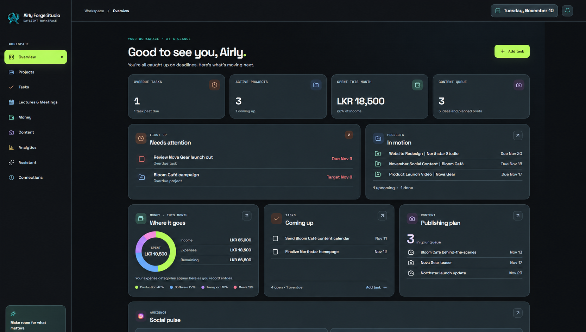
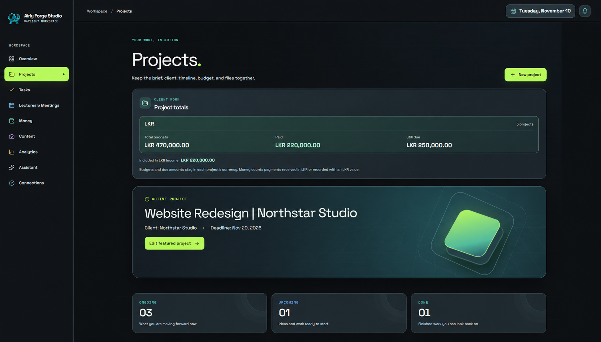
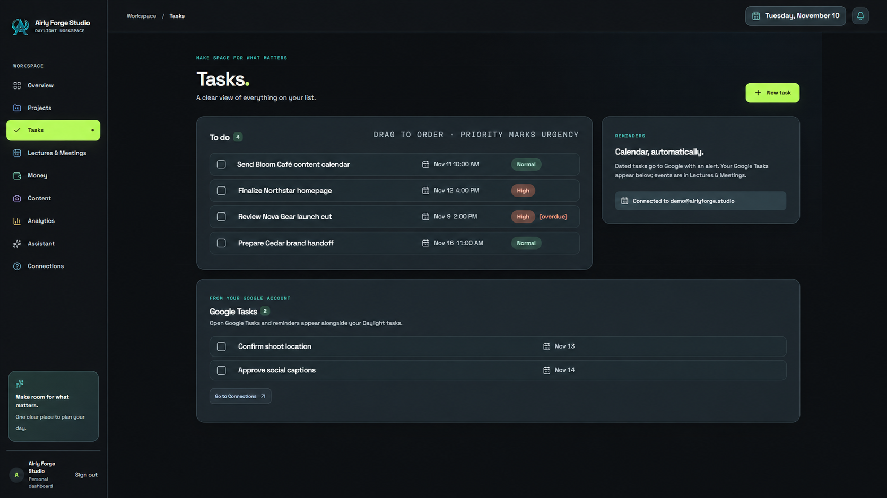
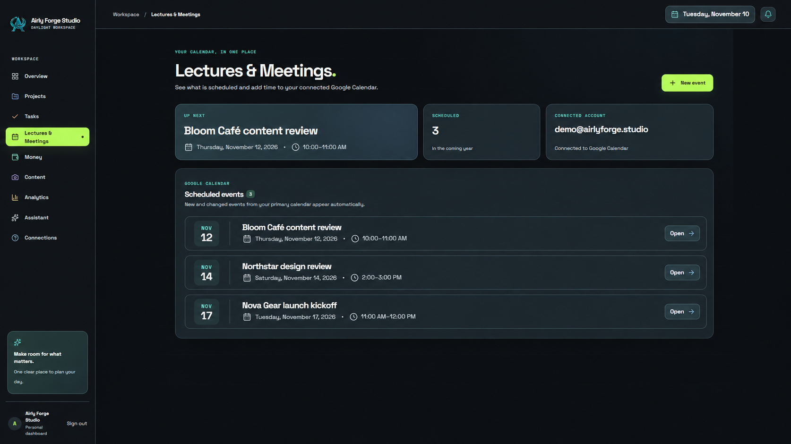
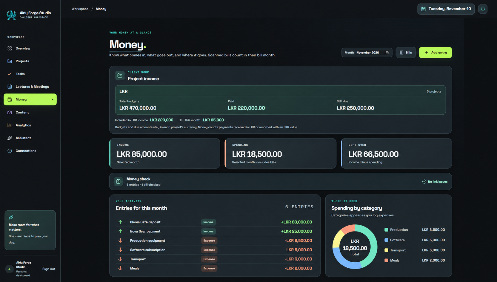
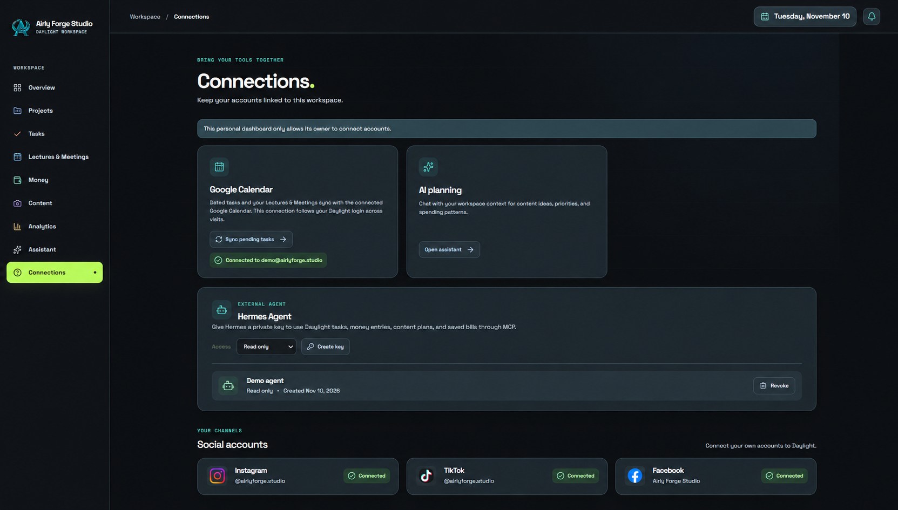

# Daylight

A personal workspace for projects, tasks, income and expenses, and content plans.

Built with Next.js, React, TypeScript, Firebase Authentication, and Cloud Firestore. Run your own copy with your own Firebase project.

## Dashboard preview

These illustrative screenshots use fictional sample projects, tasks, events, and money entries so you can see what a populated workspace looks like. They are visual examples; connecting Google and social accounts requires the optional setup below.

### Overview



### Projects



### Tasks



### Lectures & Meetings



### Money



### Connections



## Start here

The basic workspace needs **Node.js 22.13 or newer** and a **Firebase project**. Google Drive, Calendar, social analytics, AI chat, and Hermes are optional.

### 1. Set up Firebase once

1. Create a project in the [Firebase console](https://console.firebase.google.com/) and register a Web app.
2. Enable **Authentication → Sign-in method → Google**. Add `localhost` under **Authentication → Settings → Authorized domains**.
3. Create a **Cloud Firestore** database. Publish the contents of [firestore.rules](./firestore.rules) in its Rules tab.
4. Open **Project settings → Your apps** and keep the Firebase Web configuration handy.

Use your own project and credentials. You do not need the maintainer's accounts.

### 2. Download and configure

```sh
git clone https://github.com/itzkumu/daylight-public.git
cd daylight-public
node scripts/setup.mjs
npm ci
npm run dev
```

The setup helper asks for the four values from your Firebase Web configuration and writes `.env.local`. It does not create cloud resources or overwrite an existing environment file.

Prefer manual setup? Copy [.env.example](./.env.example) to `.env.local` and fill in the four values.

### 3. Use Daylight

Open [localhost:3000](http://localhost:3000), sign in with Google, and create your first task or project. Reload the page to check that it was saved.

`node scripts/setup.mjs --check` checks that required configuration values are present. It does not verify your Firebase credentials, enabled APIs, or database permissions.

## What you can use

| Feature | Setup |
| --- | --- |
| Projects, tasks, manual income and expenses, content plans | Basic Firebase setup above |
| Bill storage and project file attachments | Optional Google Drive connection and server configuration |
| Dated task sync, Google Calendar and Tasks access | Optional Google APIs and OAuth setup |
| Hermes Agent connection through MCP | Optional server credentials, owner UID, and generated agent key |
| Social analytics | Optional provider developer apps and approved permissions |
| In-app AI chat and cloud bill analysis | Optional API/provider setup; usage may incur charges |

See [optional integrations](./docs/integrations.md) when you need them. They are not prerequisites for the basic workspace.

## Deploy your own copy

1. Import your fork into Vercel.
2. Add the four `NEXT_PUBLIC_FIREBASE_*` values from your `.env.local` to the deployment's environment variables.
3. Add your deployed hostname to Firebase Authentication's authorized domains, then redeploy.
4. Sign in and verify that a task survives a reload.

For optional OAuth integrations, register callback URLs using **your deployment's domain**. Restart the local dev server or redeploy after changing environment variables.

## Troubleshooting

| Problem | Check |
| --- | --- |
| Firebase is not configured | Fill in all four values in `.env.local`, then restart |
| Google sign-in rejects the domain | Add `localhost` or your deployed hostname to Firebase authorized domains |
| Missing or insufficient permissions | Publish this repository's Firestore rules in the same Firebase project |
| A connection says it needs server settings | Follow the optional integration guide; the basic workspace does not require it |
| Dependency installation fails | Check `node --version` meets 22.13+, and keep the committed lockfile |

## Development

```sh
npm run lint
npm run build
```

## Current limits

- Server integrations are restricted to the configured `DAYLIGHT_OWNER_UID`. This is currently a personal self-hosted workspace, not a ready-to-launch shared service for everyone.
- Content plans do not automatically publish social posts.
- In-app reminders run while the app is open; they are not operating-system push notifications.
- Money and bill workflows currently use LKR; review suitability before using another currency.
- This release contains the web app. The Android client is not part of this package.
- Existing Cloudflare D1 data is not automatically migrated.

## Contributing and release status

Report reproducible bugs or suggest improvements through GitHub issues. Include what you expected, what happened, and steps to reproduce; remove credentials and personal data.

See [CONTRIBUTING.md](./CONTRIBUTING.md) for development and bug reports. The source is available under the [MIT license](./LICENSE); third-party packages and the bundled vendor stylesheet keep their own licenses.
